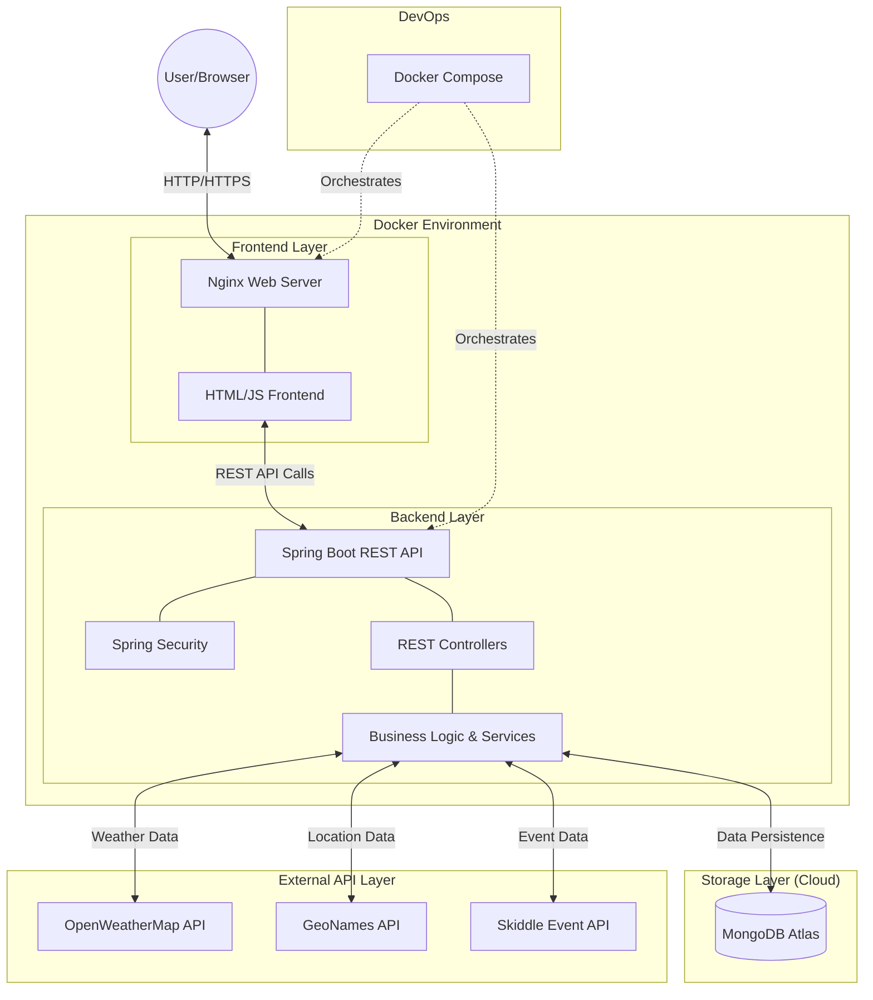

# 🎓 nottsEvents

[](https://spring.io/projects/spring-boot)
[](https://www.mongodb.com/atlas)
[](https://www.docker.com/)
[](LICENSE)

A modern, full-stack **Service-Oriented Architecture (SOA)** application designed for university student communities. This system allows students to discover, book, and host events both on and off-campus, integrated with multiple external REST APIs for real-time data enrichment.


---

## ✨ Key Features

### 📅 Event Management
- **Discover**: Browse a real-time list of student and public events.
- **Host**: Publish your own events with title, category, date, **starting time**, and location.
- **Dynamic Capacity**: Real-time tracking of seat availability and "Fully Booked" indicators.
- **Booking**: Quick one-click registration for students.

### 🔌 External API Integrations
- **Skiddle**: Fetches nearby public club/live events based on your event's specific coordinates.
- **OpenWeatherMap**: Displays a 5-day weather forecast for the venue location at the time of the event.
- **GeoNames**: Integrated location autocomplete that finds real-world coordinates for any venue worldwide.
- **Google Maps**: One-click navigation to the event venue.

### 🔒 Security & Reliability
- **Subscription Validation**: Strict backend checks ensuring only registered students can publish or book events, closing major security loopholes.
- **BCrypt Hashing**: Secure password storage using industry-standard hashing without the overhead of heavy security frameworks.
- **API Key Proxying**: Securely management of external API keys via `.env` files (keys are hidden from the frontend).
- **Global Exception Handling**: Structured JSON error responses for all backend failures.
- **Centralized Logging**: SLF4J logging for debugging authentication and external service calls.

---

## 🛠️ Tech Stack

### Backend
- **Java 21** & **Spring Boot 3**
- **Spring Data MongoDB** (Database Persistence)
- **BCrypt** (Authentication & Hashing)
- **RestTemplate** (External API Consumption)

### Frontend
- **Vanilla HTML5/CSS3** (Legacy-free design)
- **Bootstrap 5** (Responsive Layouts)
- **Leaflet.js** (Interactive Maps)
- **Fetch API** (Asynchronous REST Communication)

### Infrastructure
- **Docker & Docker Compose** (Containerization)
- **Nginx** (Reverse Proxy & Static File Hosting)
- **MongoDB Atlas** (Cloud Database)

---

## 📂 Project Structure

This project strictly adheres to **Service-Oriented Architecture (SOA)** and **Layered Architecture** principles. The codebase is entirely decoupled, with the frontend and backend living completely separate and communicating purely via RESTful JSON APIs.



```text
nottsEvents/
├── backend/ (Java Spring Boot API)
│   ├── src/main/java/com/nottsevents/
│   │   ├── controller/      # API Endpoints (EventController, StudentController) - Handles HTTP requests & validation
│   │   ├── service/         # Business Logic Layer - Executes core logic and calls external APIs (Skiddle, Weather, GeoNames)
│   │   ├── repository/      # Data Access Layer - Spring Data MongoDB interfaces for database operations
│   │   ├── model/           # Data Models - POJOs mapping to MongoDB document collections (Event, Student)
│   │   └── config/          # Global Configurations - Handles CORS, Security rules, and API key environment loading
│   ├── Dockerfile           # Multi-stage build script (compiles via Maven, packages JRE)
│   └── pom.xml              # Maven configuration defining dependencies like BCrypt and Spring Web
│
├── frontend/ (Vanilla Web Client)
│   ├── index.html           # Landing page - Main dashboard to browse and filter events
│   ├── details.html         # Interactive event hub - Shows dynamic Maps, 5-day Weather, and Nearby Skiddle events
│   ├── register.html        # Student registration gateway
│   ├── css/styles.css       # Custom stylesheet built over Bootstrap 5 utilities
│   └── js/                  
│       ├── api.js              # The core internal API wrapper - Centralizes all fetch() calls to the backend
│       ├── externalServices.js # Specialized handlers for external data visualization
│       └── (page scripts)      # Modular event listeners for specific pages (events.js, searchEvents.js, etc.)
│
└── infrastructure/
    ├── docker-compose.yml   # Docker orchestrator - glues the Nginx proxy and Java backend on a shared internal network
    └── nginx.conf           # Reverse proxy rules - routes `/api` to the backend and serves static HTML files
```

### Architectural Data Flow:
1. **User Action:** The user interacts with a vanilla HTML view (e.g., clicks "Book Event" on `details.html`).
2. **Frontend Layer:** A modular script (`details.js`) captures the event and delegates the request to the central `api.js` handler.
3. **Network Transit:** `api.js` fires an asynchronous `fetch()` payload through the **Nginx Reverse Proxy**. 
4. **Controller Layer:** The Nginx proxy forwards it to the Spring Boot `EventController`, which validates the input parameters and headers.
5. **Service Layer:** The Controller delegates to the `EventService` and `ExternalApiService` (to enrich data from Skiddle/Weather components if necessary).
6. **Persistence Layer:** The Service layer executes final queries via the `EventRepository` to modify the MongoDB Atlas cloud database.

---

## 🚀 Getting Started

### Prerequisites
- [Docker](https://www.docker.com/get-started) installed.
- A MongoDB Atlas connection string and API keys for Skiddle, OpenWeatherMap, and GeoNames.

### 1. Configure Environment
Copy `.env.example` to `.env` in the root directory, then fill in your own MongoDB connection string and API credentials. Keep `.env` private; it is excluded from Git.
```bash
cp .env.example .env
```

- [x] Launch with Docker: `docker compose up --build -d`
- [x] Access the application: **`http://localhost:8080`**


## 📋 API Endpoints Summary

| Method | Endpoint | Description |
| :--- | :--- | :--- |
| `GET` | `/api/events` | Fetch all events (with optional filters) |
| `POST` | `/api/events/add` | Create a new event (requires Registration) |
| `GET` | `/api/events/{id}` | Get event details + Weather + Nearby Events |
| `GET` | `/api/events/nearby` | Geospatial Search (Haversine formula) |
| `POST` | `/api/students/register` | Register new student account |
| `POST` | `/api/students/login` | Authenticate student |
| `PUT` | `/api/events/book` | Book an event (requires Registration) |

---

## 🔬 Coursework Notes
This project was developed for the **SOCT Coursework 2026**. It demonstrates core SOA principles, including:
1. **Loose Coupling**: Frontend and backend communicate only via JSON REST endpoints.
2. **Encapsulation**: Backend services handle all complex logic and external API communication.
3. **Reusability**: Shared repository logic for student and event entities.
4. **Service Integration**: Seamlessly orchestrating multiple third-party data providers.

---
© 2026 Notts Event Booking System